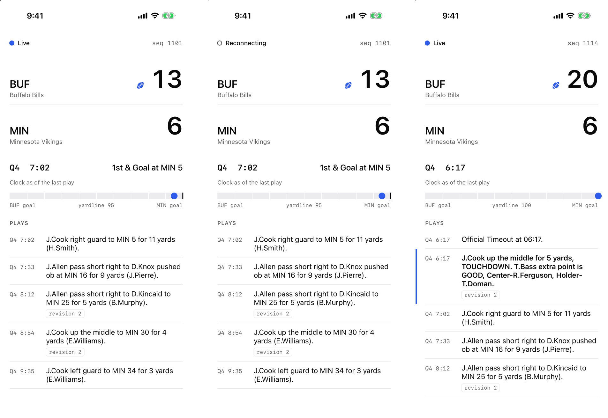

# A live NFL scoreboard in SwiftUI, and the small server that holds the key

A SwiftUI app for iOS 17 and macOS 14 that follows one NFL game and keeps showing the right score after the phone loses its connection. The app reads server-sent events from a small Node server, and the server holds the [Statpad](https://statpad.dev) API key, because a key shipped inside an app is readable by anyone who opens the app. Every event id is a Statpad `seq`, so a phone that comes back sends `Last-Event-ID` and gets exactly the changes it missed in one event.

It runs with no key against a recorded game, Bills at Vikings on November 9, 2026. The full write-up is [on the Statpad blog](https://statpad.dev/blog/swiftui-live-scoreboard/).



The screenshots are the iOS Simulator during the replay below. On the left the board is at seq 1101, Buffalo up 13-6 with 1st and goal at the Minnesota 5. In the middle the app is cut off while the game goes on. On the right it has reconnected with `Last-Event-ID: 1101` and is at seq 1114, 20-6, with the touchdown listed once and its extra point added.

## Run it with no key

You need Node 20.12 or later and Xcode 26 or later.

```sh
cd server
npm ci
npm start -- --replay ../data/nfl-bills-at-vikings --from 1101 --hold 30 --speed 20
```

The replay applies seqs 1 to 1101 at once, holds there for 30 seconds, then plays on at 20 times game speed. `--replay=` with no path reads the same files from statpad.dev/samples instead of the copy in `data/`.

Open `App/Scoreboard.xcodeproj` and run the Scoreboard scheme on an iOS 17 or later Simulator, or on My Mac. The app connects to `http://127.0.0.1:8787`. You can watch the same stream with curl:

```sh
curl -N localhost:8787/games/01a1d60f-67be-7bdd-83f4-53286521d9bb/events
```

To repeat the reconnect in the screenshots, put a proxy between the app and the server, stop it while the replay holds at 1101, and start it again after the replay has moved on:

```sh
node scripts/flaky-proxy.mjs 8788 8787
SIMCTL_CHILD_SCOREBOARD_SERVER=http://127.0.0.1:8788 xcrun simctl launch booted dev.statpad.blog.scoreboard
```

The server logs `phone resumed after 1101: 9 changes, now at 1114` when the app comes back.

## Run it live

Live mode needs a Statpad API key. Every account starts on the Free plan with no card at [app.statpad.dev](https://app.statpad.dev/sign-up). Put the key in `server/.env`, which git ignores:

```sh
cp server/.env.example server/.env   # then paste your key into it
```

The recorded game's id only exists in the samples, so pick a game that's on today and pass its id. `date` is a day in US Eastern time:

```sh
curl "https://api.statpad.dev/v1/nfl/games?date=2026-11-30" -H "Authorization: Bearer $STATPAD_API_KEY"
```

Then start the server in the mode your plan allows:

```sh
npm start -- --game <game id> --poll   # Free, Developer and every other plan: polls the changes feed
npm start -- --game <game id>          # Pro, Business and the Pro trial: one WebSocket subscription
```

Run the app with `SCOREBOARD_GAME=<game id>` in the scheme's environment, or `SIMCTL_CHILD_SCOREBOARD_GAME` with `xcrun simctl launch`. `SCOREBOARD_SERVER` points it at a server other than `http://127.0.0.1:8787`.

| Mode | Plans | What it costs |
| --- | --- | --- |
| `--poll` | Every plan, Free included | One request per poll, every 5 seconds once caught up. This game ran 3 h 10 min from the first play to the last, which is about 2,290 requests, most of Free's 2,500 a month. Start it near kickoff, because it polls from the moment it starts. It stops on its own after the final and on `quota_exhausted`. |
| Stream | Pro, Business and the Pro trial | One request for the subscribe and one for each change delivered, about 1,300 for an NFL game. Free and Developer have no stream, and the gateway closes the socket with 1008. |

Either way the server makes one game read and one plays read at startup, and the cost is the same however many phones connect to it. Plan limits are on [statpad.dev/pricing](https://statpad.dev/pricing). The API covers 11 leagues ([coverage](https://statpad.dev/docs/coverage)), and this app draws football, so it follows NFL games.

## Why the app reads bytes, not lines

`URLSession.bytes(for:).lines` skips empty lines, and in server-sent events an empty line is what ends an event. With Swift 6.4 and Xcode 27 on macOS 27, a six-line file with two empty lines comes back as four lines, and the test `linesSkipsTheEmptyLinesThatEndEvents` checks this on every run. So `readEvents` in [ServerEvents.swift](App/ScoreboardKit/Sources/ScoreboardKit/ServerEvents.swift) splits the bytes itself:

```swift
for try await byte in bytes {
    if byte != UInt8(ascii: "\n") {
        line.append(byte)
        continue
    }
    let text = String(decoding: line, as: UTF8.self)
    line.removeAll(keepingCapacity: true)
    if text.isEmpty {
        if !event.data.isEmpty { yield(event) }
        event = ServerEvent()
        continue
    }
    // ... the id:, event: and data: fields
}
```

## How it stays right after a reconnect

When the phone drops at 1101 and comes back two minutes later, the changes it missed don't arrive in the order a scoreboard wants. Seq 1104 sets the score to 19-6, the touchdown play is seq 1106, and at 1111 the same play arrives again as version 2 with the extra point added. Three rules keep the board right:

1. Each event's id is the seq of the last change in it. [LiveFeed](App/ScoreboardKit/Sources/ScoreboardKit/LiveFeed.swift) sends the last applied seq back on every reconnect, and the server answers with what the phone missed in one event:

   ```swift
   if store.seq > 0 { request.setValue(String(store.seq), forHTTPHeaderField: "Last-Event-ID") }
   ```

2. [GameStore](App/ScoreboardKit/Sources/ScoreboardKit/GameStore.swift) applies one event's changes in one synchronous call on the main actor, so SwiftUI never renders half of an event.
3. Plays are keyed by id, so a newer version of a play replaces its row.

The server follows the same rules toward Statpad. It resumes the stream from the last seq it applied, reads the game again on `resync_required` or `invalid_resume`, and stops on a 1008 close, as [statpad.dev/docs/streaming](https://statpad.dev/docs/streaming) describes.

## Tests

```sh
cd App/ScoreboardKit && swift test
cd server && npm test
```

`ScoreboardKit` has 10 Swift Testing tests. Six run the recorded game's 1,277 changes through `GameStore`, three cover the event reader, and one runs `LiveFeed` through a dropped connection and checks the second request carries `Last-Event-ID: 1101`. The server has 20 `node:test` tests for the hub, the event route, the stream client against a local stand-in for the gateway, and the polling loop.

## What's here

- `App/ScoreboardKit/` is a Swift package with the models, `GameStore`, the event reader, `LiveFeed` and the tests.
- `App/Scoreboard/` is the SwiftUI app, one target for iOS and macOS. `Scoreboard.xcodeproj` is generated from `project.yml` with [XcodeGen](https://github.com/yonaskolb/XcodeGen), so run `xcodegen generate` in `App/` after editing `project.yml`.
- `server/` is TypeScript on [`@statpad/sdk`](https://www.npmjs.com/package/@statpad/sdk) and `ws`. It serves `GET /games/:id` and `GET /games/:id/events`.
- `data/nfl-bills-at-vikings/` holds `changes.ndjson`, `game.json` and `game-live.json`, the same files as [statpad.dev/samples](https://statpad.dev/docs/replay), so the replay and the tests work offline.
- `scripts/facts.mjs` prints the numbers the write-up quotes, and `scripts/flaky-proxy.mjs` is the proxy for the reconnect demo.

Statpad isn't affiliated with the NFL or any team. The game data is a recording of a real game, and team names appear as text only.

## License

MIT. See [LICENSE](LICENSE).
